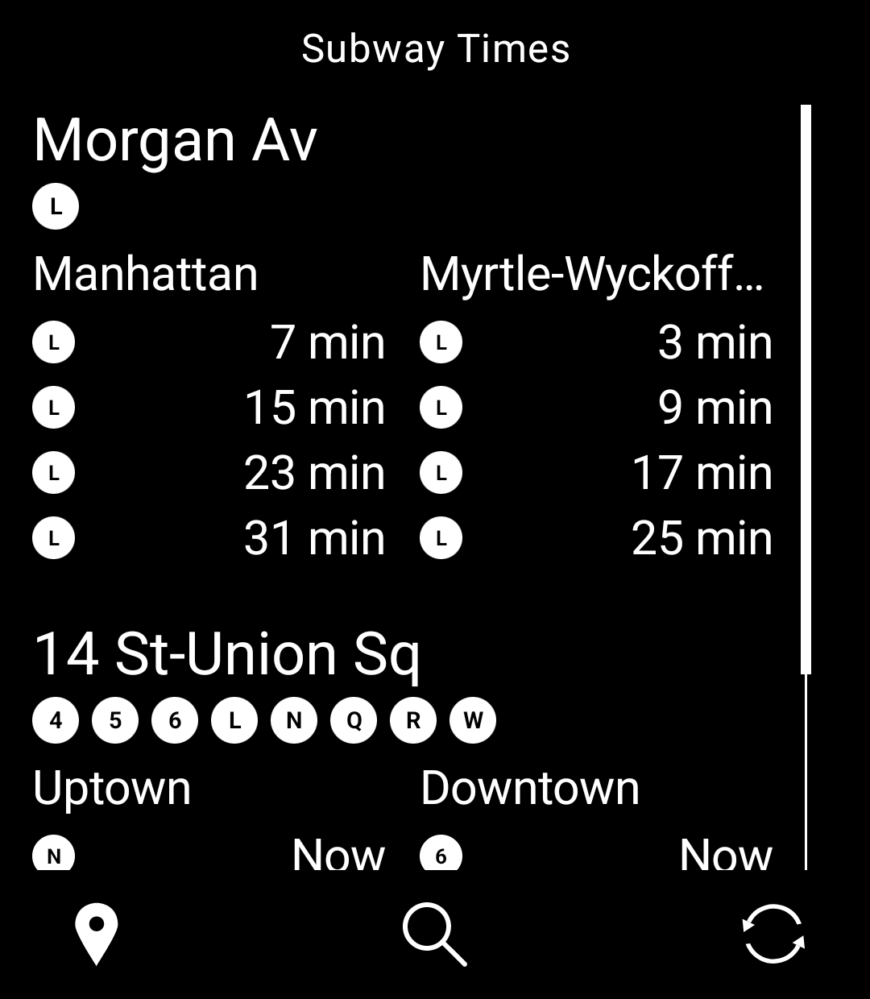
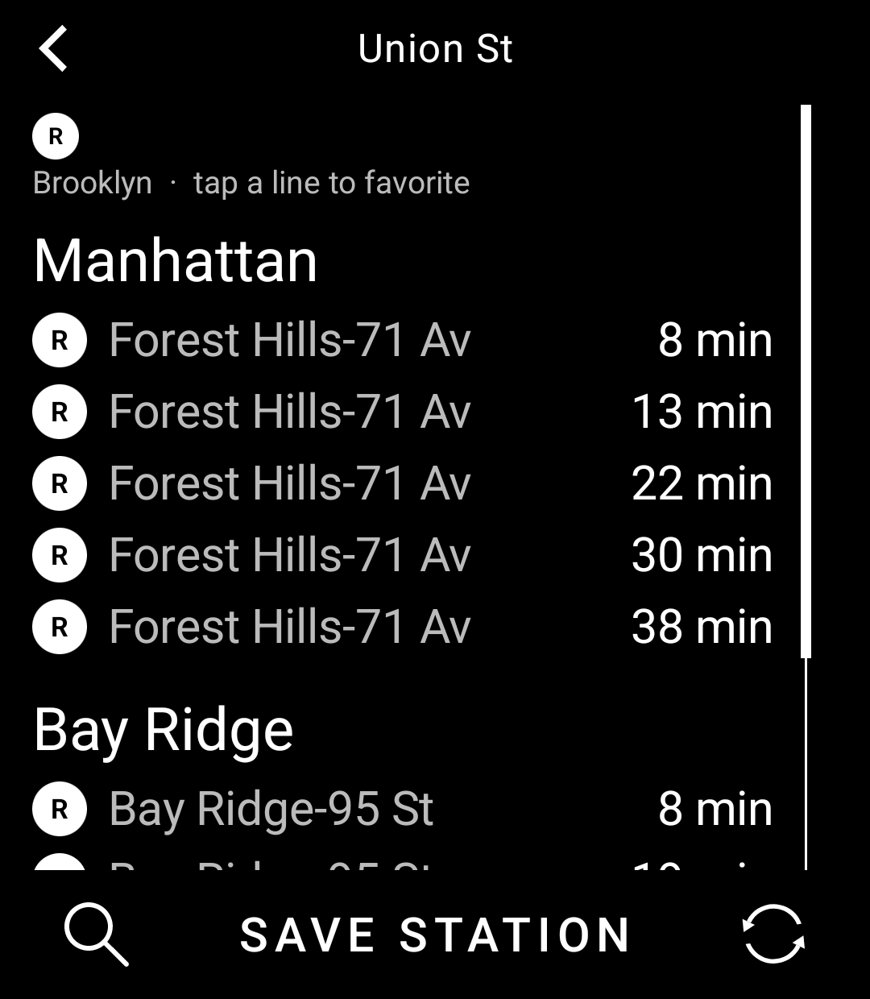
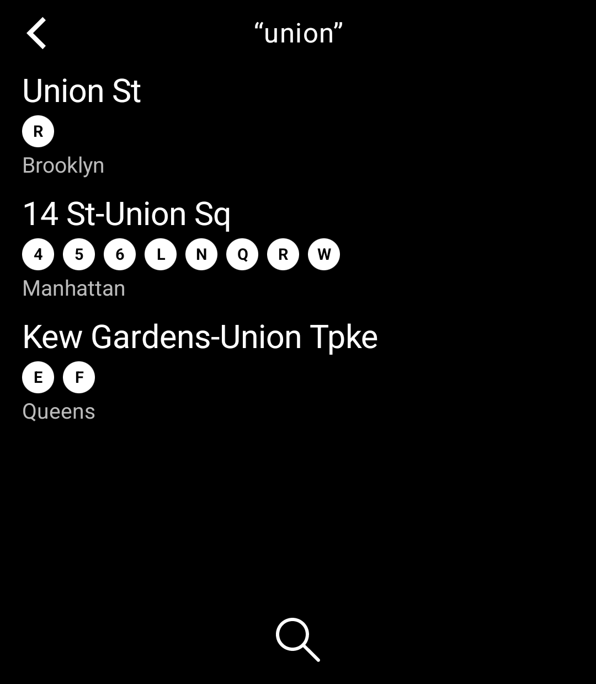
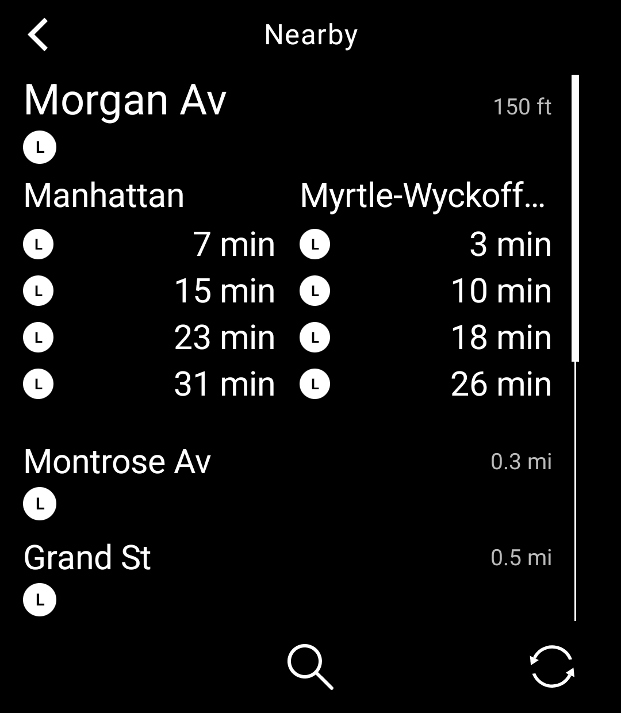

<a href="https://github.com/sponsors/gi-os"></a>

# BrightNYCSubway Lite

> **This is the Lite version.** BrightNYCSubway Lite is built only with Light's official SDK, so it can go in the Light Tool Library. It has the same features as the full app, [BrightTransit](https://github.com/gi-os/BrightTransit) ([on BrightMarket](https://brightmarket.gzl.dev/app/com.thelightphone.lightnycsubway/)), which is the sideloaded build of the same code.

Live New York City subway arrivals for the Light Phone III, built with the official LightOS SDK for the Light Tool Library.

It reads the MTA's public GTFS-realtime feeds straight from the phone. There is no server in the middle and no API key.

## What it does

- **Home** is the stations you saved, each with the next trains in both directions. Nothing else.
- **Directions use real names.** The L at Morgan Av says "Manhattan" and "Brooklyn", not "Uptown" and "Downtown". Where the MTA only gives a compass word, the direction is named after where the train is going, and every train on a station page shows its last stop, read from the live feed. A train that is turning back early says so.
- **Service alerts.** A station page shows the MTA's alerts that are in effect right now: delays on its lines, a suspension anywhere along them, and work or notices at that station. On Home a station with something wrong gets one line saying what.
- **Search forgives.** Words match in any order, spelled out or abbreviated ("14th Street Union Square"), with a typo or two, and by the names people actually use ("Myrtle Broadway", "Port Authority", "Citi Field"). Search opens straight on the keyboard.
- **Nearby** (the pin) lists the closest stations and shows the trains at the nearest one.
- **Times keep themselves current.** They count down on their own and are fetched again every 30 seconds while the screen is showing. If the signal drops, the last times stay up and are marked as not live.
- **Favorite lines.** Tap a line on a station page to favorite it. It gets a small star, and its trains come first on that station's page and on Home.
- **Trains are grouped by where they go**, not by the feed's north and south. At Delancey St-Essex St the F and the J to Brooklyn are listed together.
- **Follow a train.** Tap a train on a station's page to see every stop it has left and when it gets to each. Tap your stop, and the screen counts the stops down to it in large type: "5 stops to 14 St-Union Sq", then "Next", then "Now". If the tool is closed in the middle of a ride it opens on the ride again.
- **Direct trains.** Search from a station's page, and the station you open says which train runs to it from the one you searched from, when it leaves there and when it arrives. Tap it for every direct train, and tap a train to count down to your stop.
- **Trips with one change.** Where no train runs direct, or a change gets you there at least five minutes sooner, it also offers a way with one change: "Change at 14 St-Union Sq to the 4 or 5", how long you have to change, and when you arrive. A change is only offered inside one station, through a transfer the MTA lists, with the MTA's own time to walk it and four minutes to spare, and only when the first train is a real, moving train. On a recording of every train one Thursday afternoon, a change offered with two moving trains held as named 98.4% of the time, as often as a direct train is caught. Tap it to count down to the change. When you get there, NEXT TRAIN shows the live trains from there.

Following a train only works while the tool is open and the screen is lit. Light's SDK gives a tool no notifications, vibration or background work, so it cannot tell you when to get up: it is right when you look at it. With no signal the count turns grey, is worked out from the train's last times, and says how old they are. A grey count never rises while there is no signal. When the signal comes back it can be put right by a stop, rarely two. After five minutes with no signal it stops counting and says so.

One row of buttons along the bottom of every screen: nearby, search, refresh.

<p>




</p>

## How this relates to BrightTransit

The code comes from [gi-os/BrightTransit](https://github.com/gi-os/BrightTransit), the sideloaded build ("Subway Times"). There the tool sits in `examples/LightNYCSubway` with the id `com.thelightphone.lightnycsubway`. Light's builder only builds the `tool/` module, and a Tool Library tool needs an id outside Light's namespace. So here the tool is in `tool/` with the id `com.gios.brightnycsubwaylite`. Both can be installed side by side.

## Data

The phone talks to the MTA feeds and nothing else. Your saved station stays on the phone. The times to change trains come from the MTA's published schedule (`tool/scripts/transfers.txt`) and are built into the station file.

## Build

```sh
./gradlew -DlightSdk.toolOnly=true :tool:assembleDebug
./gradlew -DlightSdk.toolOnly=true :tool:testDebugUnitTest
```

The tests run against the real station file, a captured L feed, a captured alerts feed, two snapshots of every train in the system, and short recordings of single trains (`tool/scripts/capture_feeds.py`, `tool/scripts/cut_replay.py`). They cover the feed readers, direction names, alerts, search, the feed caches, following a train, direct trains, and trips with a change. The expected trips in the planner's tests were worked out a second time in Python from the rules in words (`tool/scripts/direct_trains.py`, `tool/scripts/change_trains.py`).

`tool/src/main/assets/stations.json` is generated from the MTA's open station table and the transfers file from its schedule:

```sh
python3 tool/scripts/build_stations.py
```

The alerts fixture is cut from a live download of the alerts feed (the script says where to get one):

```sh
python3 tool/scripts/trim_alerts.py /tmp/subway-alerts.pb
```

Built on [lightphone/light-sdk](https://github.com/lightphone/light-sdk) (MIT).
